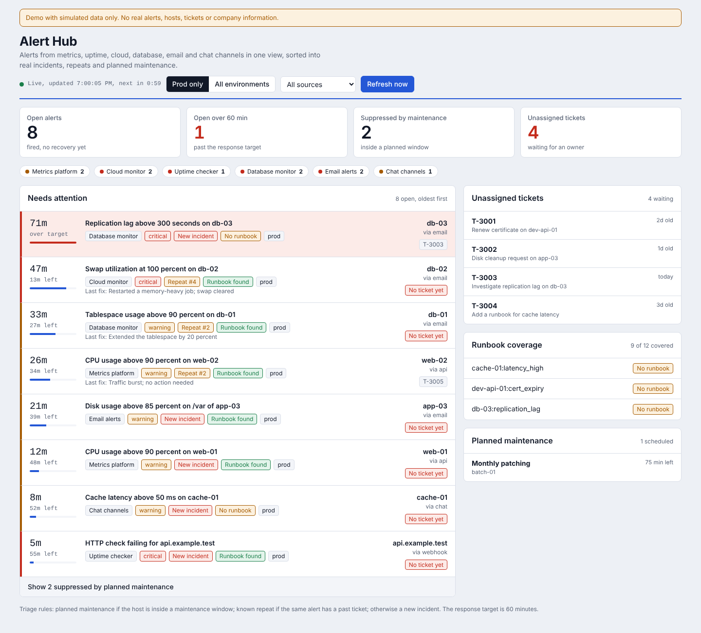

# Alert Hub (demo)

A small demo of a **centralized alert view**: alerts from many monitoring tools and channels land in one dashboard and are sorted into new incidents, known repeats and planned maintenance.

> All data in this repository is simulated. Hosts, alerts, tickets and runbooks are invented for the demo.



*Screenshot of the demo with simulated data.*

## The problem

When alerts arrive through several tools, mailboxes and chat channels, it is hard to see what is open, what is overdue and what can be ignored because it is planned work.

## What it does

- Brings six simulated sources into one view: a metrics platform, an uptime checker, a cloud monitor, a database monitor, email alerts and chat channels
- Applies the same triage rules to every alert (see `docs/triage-rules.md`)
- Shows time left against a 60-minute response target
- Flags alerts with no ticket and alert types with no runbook
- Lists unassigned tickets and planned maintenance windows
- Refreshes every 60 seconds with simulated new and recovered alerts

## Flow

```
sources (6) -> normalize -> maintenance? -> known repeat? -> new incident -> dashboard
```

## Run it

- **Dashboard:** open `dashboard/index.html` in a browser. No install needed.
- **Triage script:** `python3 triage.py` prints the same classification in a terminal.
- **Online:** enable GitHub Pages for this repo (Settings > Pages > deploy from the `main` branch) and open `/dashboard/`.

## Files

| Path | Purpose |
| --- | --- |
| `dashboard/index.html` | The dashboard (one file, data embedded) |
| `sample-data/` | Fake alerts, tickets, maintenance windows and runbooks |
| `triage.py` | Rules in Python, so they are easy to read and test |
| `docs/triage-rules.md` | The rules in plain language |

## Skills shown

Alert triage design, monitoring and incident response workflow, runbook coverage, Python and JavaScript, JSON data modelling.

## Next ideas

- Read real alerts from a webhook instead of sample files
- Add unit tests for `classify`
- Add an AI-assisted suggestion step for a person to approve

## Licence

MIT. See `LICENSE`.
